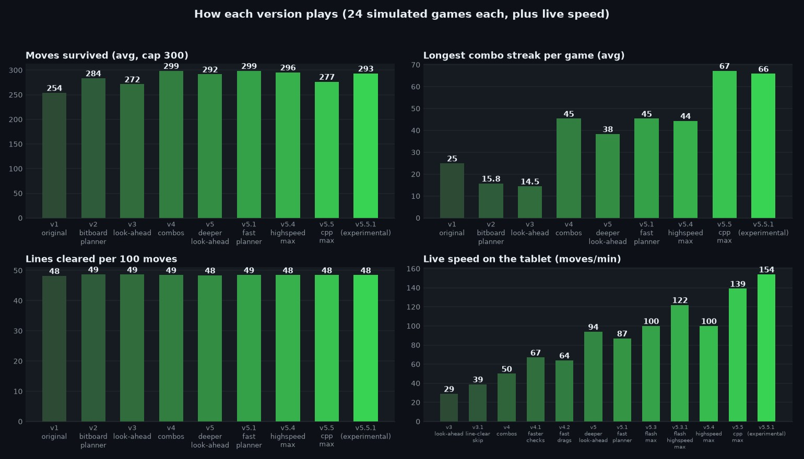

# Block Blast bot

A C++ bot that plays the mobile puzzle game **Block Blast** (Classic mode) on an Android device over USB or Wi-Fi. It reads the board and tray from the screen, plans moves with a bitboard search, and drags the pieces. It plays continuously: it chases the best score, keeps going after it beats it, and starts a new game when it loses.

The current version is **v5.5-cpp-max** (C++, with a small Java helper on the tablet). Versions up to v5.4 were Python; they are kept in `versions/` and in the git history.

> Unofficial fan project, not affiliated with the makers of Block Blast.

## Benchmark



Every planner version plays the same simulated games (`python bench.py`); live speed is measured on the tablet from `bot.log`.

| Version | What changed |
|---|---|
| v1 original | One piece at a time with a simple board score; fixed waits after every move. |
| v2 bitboard planner | Plans all three tray pieces together on a 64-bit bitboard. |
| v3 look-ahead | Samples likely future trays when the board fills up; learns each colour theme. |
| v3.1 line-clear skip | Doesn't wait for line-clear animations; works with the navigation bar shown. |
| v4 combos | Keeps combo streaks alive; swipes a whole tray and checks the board once per tray. |
| v4.1 faster checks | Reads the board through combo pop-up text, no fixed waits, one long-lived adb shell for swipes (same planner as v4). |
| v4.2 fast drags | 150 ms drags, new trays planned from one screenshot, wood-theme tray fix. Measured late in a ~400k game, where planning and line clears take longer, so it isn't directly comparable with v4.1's early-game 67. |
| v5 deeper look-ahead | Planning ~6x faster (bit tricks + look-ahead in worker processes), so it can sample 32 future trays instead of 16. Missed fast drops are spotted in ~0.8 s and retried with a slow drag; after a miss, long drags slow down. On 20 longer games (600 moves) it survived longer (503 vs 466 moves); on the chart's 24 games it was slightly behind v4 — about even overall. Live speed measured early in a new game. |
| v5.1 fast planner | Back to the lighter look-ahead (16 future trays; the deeper one wasn't clearly better) with work spread evenly over the CPU cores: planning ~0.03 s per tray. Also handles the blue bevelled theme and size changes between menu and board. Live 87/min was measured over 865 moves (a longer run than v5's 302 early-game moves), median tray 100/min. |
| v5.3 flash max | Same planner as v5.1. No check screenshot after each tray (the next tray's screenshot confirms the board), learned wait for the game to deal the next tray, 120 ms drags. 100 moves/min over 302 live moves (median tray 1.3 s). Trade-off: its picture of the board can drift without the per-tray check; one game ended earlier than it should have because of that. |
| v5.3.1 flash highspeed max | Same planner. Stricter board check from the screenshot it already takes: a block the screen shows empty is removed at once; extra blocks are added only when nothing is animating (combo text is drawn in flat letters that look like blocks). Fewer re-reads, so most trays need one screenshot. 80 ms drags. 122 moves/min over 301 live moves (average tray 1.41 s), no missed drops. |
| v5.4 highspeed max | Fast like v5.3.1 while the board is open; careful when it is crowded (28+ cells after a tray): a deeper look-ahead (48 future trays) and a real check screenshot. A board that looks very different from the bot's picture is read carefully before planning. On 20 long games (up to 600 moves) it survived 494 moves vs v5.1's 466 and was never worse; on the chart's 24 shorter games it is about even with v5.1 (296 vs 299). ~100 moves/min live. The last Python version (`versions/v5.4-highspeed-max/`). |
| v5.5 cpp max | **Rewritten in C++**, with a small Java helper on the tablet that mirrors the screen (a frame in 0.04 s instead of 0.37 s) and injects touches directly. Planning takes ~2–5 ms per tray, so the look-ahead is much deeper (64 future trays x 16 candidates) and plays future trays keeping the combo going. Every drop is checked, so the board picture doesn't drift. **139 moves/min** over 688 live moves with no board corrections. Longest combo streak 67 vs v5.1's 45. Survival: on the chart's 24 games it lost 4 before 300 moves (v5.1: 1), but on 96 other games capped at 300 it reached the cap 83 times vs v5.1's 77, and on 96 games up to 1500 moves it survived 1161 moves on average vs v5.1's 945 (`build\sim.exe`); 24 games are too few to separate them. |
| v5.5.1 (experimental) | v5.5 with a planner tuned for **long-horizon survival** (`versions/v5.5.1-exp/`): it weighs the worst quarter of sampled futures (70%) instead of only their average, switches to careful mode from 24 filled cells, and there looks two future trays ahead. On 128 simulated games up to 3000 moves it lasted the full 3000 moves in 54 games vs v5.5's 29 (average 1992 vs 1616 moves), with longer combo streaks. On the chart's 24 games: 23 reach 300 moves (v5.5: 20, v5.1: 23), streak 66. **154 moves/min** over 750 live moves, no board corrections (same drag-and-check code as v5.5; the difference is likely game state). |

## How it works

1. **See** – a helper running on the tablet (`helper/BBHelper.java`, started by the bot over adb) keeps a live mirror of the screen in memory, so the latest frame arrives in ~0.04 s; without it the bot falls back to `screencap` (~0.37 s). The game changes colour theme as the score rises (dark, pink, mint, white, wood, ice…), so instead of fixed colours the bot learns what an empty cell looks like: empty cells share one colour, and after each move it re-learns that colour from cells it knows are empty. New tray pieces grow in, so a tray is only read once its pieces hold still.
2. **Plan** – `src/planner.cpp` searches every order and position of the tray pieces on a 64-bit bitboard. Boards are scored for open space, holes, ragged edges, and room for big pieces (3×3, 1×5), plus how likely a random next piece fits. The best candidates then play 64 sampled future trays each (on all CPU cores) and the plan that keeps surviving wins. It also tracks the combo streak (a line cleared within every 3 placements): clears that extend the streak score extra, breaking it costs, and the future trays are played keeping the streak alive.
3. **Act** – the helper drags each piece (80 ms) and the bot checks the drop on the next frame; a missed drop is retried at once (slowly, then one cell over), and small per-piece aim corrections are learned. The game moves a held piece about 1.47× the finger distance, and the aim accounts for that. Line-clear animations aren't waited for: a move counts as done once the rest of the board matches.
4. **Recover** – detects the menu, the result screen (taps play again), rating prompts and some ads; presses Back only when another app (e.g. an ad's store page) stays in front. Unknown screens are saved to `unknown-screens/` for calibration.

## Setup

- Windows, Android platform-tools (`adb` on your PATH), USB debugging on the device (or Wireless debugging: pair once with `python adbwifi.py pair`).
- The built `bbbot.exe` and `helper/bbhelper.dex` are in the repo. To rebuild: MinGW-w64 g++ (`winget install BrechtSanders.WinLibs.POSIX.UCRT`) and `.\build.ps1`; the helper needs a JDK and the Android SDK (`.\helper\build-helper.ps1`).
- The screen coordinates are calibrated for a **2880×1800 landscape** display (constants in `src/vision.hpp`). Other resolutions need recalibration. A visible navigation bar is handled automatically.

## Usage

```bash
bbbot.exe                 # dry run: read the screen and print the planned move
bbbot.exe --play          # play (Ctrl+C to stop)
```

Run it in the background (output in `bot.log`, errors in `bot-error.log`):

```bash
powershell -NoProfile -ExecutionPolicy Bypass -File .\start-bot.ps1
powershell -NoProfile -ExecutionPolicy Bypass -File .\stop-bot.ps1
```

Other versions live in `versions/<name>/` and run with `.\start-bot.ps1 -Version <name>` (Python ones need `python -m pip install -r requirements.txt`).

Options: `--swipe-ms` (drag duration, default 80), `--gap-ms` (pause between drags, default 40), `--pickup-y` (where a lifted piece appears). `BB_DEBUG=1` saves the screen to `debug-frames/` when a check times out.

## Testing the planner offline

```bash
build\sim.exe 96 1500 7000         # 96 simulated games up to 1500 moves (after .\build.ps1)
build\sim.exe 96 1500 7000 v51     # the same games with v5.1's settings, for comparison
python bench.py 24 300             # every version from git history; writes benchmark.jpg
```

## License

GNU General Public License v3.0 — see [LICENSE](LICENSE).
